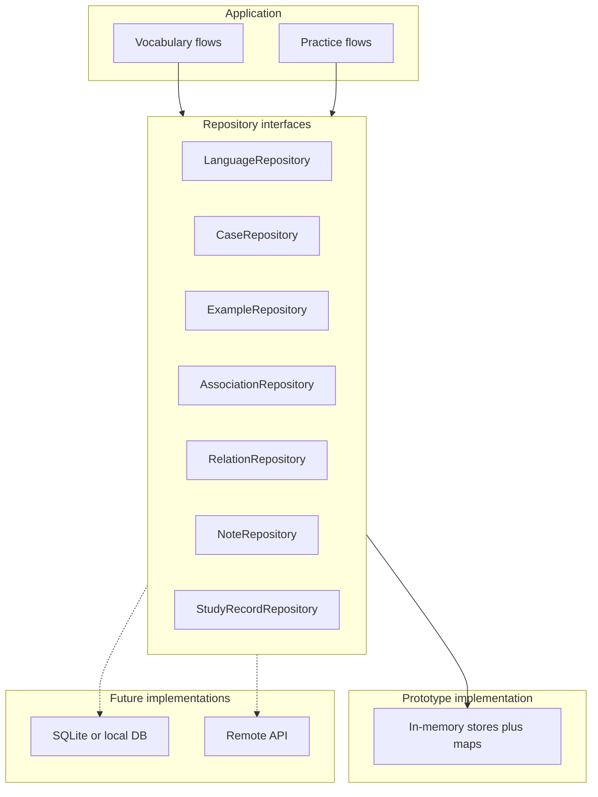

# ASU — Database Architecture Sketch

Conceptual data design for ASU: **entities, attributes, relationships, and integrity rules** without tying to a specific engine. This version matches your decisions:

- **Case** (not usecase/sense) as the center of the graph  
- **Lemma text on the case**; **no lemma table** in this stage; **no `used_as`**  
- **Example** (not context / case_show)  
- **Relation** between cases (simple pair model for the prototype)  
- **Languages only**—**no collections**  
- **Many associations per case**, SRS **one card per case**  
- **No learner/user table**; single implicit learner  
- **Persistence:** in-memory data behind **repository** interfaces that mirror this model (future swap to real DB)

---

## Design principles

1. **Case is the anchor** for examples, associations, notes, relations, and study records.
2. **Single implicit learner:** study record primary key is `case_id` until a `Learner` entity exists.
3. **Repositories mirror this schema** in memory so a later SQLite or API layer implements the same contracts.
4. **Relations are directed rows** (`left_case_id` → `right_case_id`) + relation kind. **Bidirectional** kinds store **two rows** (A→B and B→A) so reads stay simple; **unidirectional** kinds store **one row**.
5. **Grading is numeric on the study record**; **status** is a separate lifecycle field for queue UI.

---

## Entity-relationship overview

```mermaid
erDiagram
  Language ||--o{ Case : contains
  Case ||--o{ Example : illustrates
  Case ||--o{ Association : memory_cue
  Case ||--o| StudyRecord : srs_state
  Case ||--o{ CaseRelation : participates
  Relation ||--o{ CaseRelation : classifies
  Note ||--o{ CaseNote : attached
  Case ||--o{ CaseNote : has

  Language {
    int id PK
    string display_name
    string icon_ref
  }

  Case {
    int id PK
    int language_id FK
    string lemma_text
    string translation_optional
    string description_optional
    string image_ref_optional
    int formality_optional
    int connotation_optional
    int rudeness_optional
  }

  Example {
    int id PK
    int case_id FK
    string text
  }

  Association {
    int id PK
    int case_id FK
    string kind
    string content_ref
    int sort_order_optional
    datetime created_at
  }

  StudyRecord {
    int case_id PK_FK
    string review_status
    float scheduling_strength_numeric
    int repetitions_count
    datetime last_repetition_at_optional
    datetime due_at_optional
  }

  Relation {
    int id PK
    string name
    string direction
  }

  CaseRelation {
    int left_case_id FK
    int right_case_id FK
    int relation_id FK
  }

  Note {
    int id PK
    string content
  }

  CaseNote {
    int case_id FK
    int note_id FK
  }
```

---

## Relation between cases

Each **CaseRelation** row is a **directed edge**: from `left_case_id` to `right_case_id`, labeled by **Relation** (synonym, antonym, …).

| Attribute | Purpose |
|-----------|---------|
| `left_case_id`, `right_case_id` | Directed edge: left → right |
| `relation_id` FK | Relation kind from the catalog |

Composite primary key: `(left_case_id, right_case_id, relation_id)`.

### Unidirectional vs bidirectional (storage rule)

**Relation** (kind) includes `direction`:

| `direction` | Rows stored | Meaning |
|-------------|-------------|---------|
| **unidirectional** | **One** row: `(A, B)` | Only A → B (e.g. “is a type of”, “derived from”) |
| **bidirectional** | **Two** rows: `(A, B)` and `(B, A)` | Same kind both ways (e.g. synonym, antonym, “often confused with”) |

#### Why duplicate for bidirectional (recommended)

**Option A — single row for symmetric links:** store one row with a canonical order (e.g. always `left_id < right_id`) and query with `left = X OR right = X`.

- Fewer rows, one source of truth.
- Every list/detail query needs OR logic or a union view; easy to get wrong in one repository method.
- UI that thinks in “from this case, what is related?” fights the schema.

**Option B — two rows for bidirectional kinds (chosen):** mirror the edge when the kind is bidirectional.

- **Read rule:** “relations from case X” is always `WHERE left_case_id = X`—no branch per direction.
- **Mental model:** each row reads as an arrow; bidirectional kinds are two arrows; unidirectional kinds one arrow.
- **Cost:** create/delete must run in **pairs** for bidirectional kinds (enforced in the relation repository, not left to every caller).

That tradeoff fits a prototype and in-memory repos: slightly more write discipline, much simpler reads and debugging when you inspect the store.

#### Write / delete invariants (repository responsibility)

| Action | Unidirectional kind | Bidirectional kind |
|--------|---------------------|---------------------|
| **Create** link A—B | Insert `(A, B)` | Insert `(A, B)` and `(B, A)` |
| **Delete** link A—B | Delete `(A, B)` | Delete both `(A, B)` and `(B, A)` |
| **Existence check** | `(A, B)` present | both rows present (or check one + kind’s direction) |

Do **not** insert `(B, A)` for a unidirectional kind unless the product explicitly allows reversing the semantic (separate user action).

#### Example

Synonym (bidirectional) between cases 10 and 20:

| left_case_id | right_case_id | relation_id |
|--------------|---------------|-------------|
| 10 | 20 | synonym |
| 20 | 10 | synonym |

“Is a hypernym of” (unidirectional) 30 → 40:

| left_case_id | right_case_id | relation_id |
|--------------|---------------|-------------|
| 30 | 40 | hypernym |

---

## Entity specifications

### Language

- **Purpose:** Sole grouping layer for cases in this stage.
- **Attributes:** display name, icon reference.
- **Rules:** Every case belongs to exactly one language; delete language cascades to its cases (and downstream rows).

### Case

- **Purpose:** Single learnable unit; one SRS card.
- **Attributes:**
  - `lemma_text` — surface form / headword text for this case (no separate lemma row).
  - Optional: translation, description, image reference.
  - Optional nuance integers: formality, connotation, rudeness (neutral defaults).
- **Rules:** No parent/child case tree in this stage. No `used_as` column.

### Example

- **Purpose:** Sample sentence or snippet for a case.
- **Attributes:** `text`.
- **Rules:** Many per case; cascade delete with case.

### Association

- **Purpose:** Memory cues (image, audio, sketch, text, video, …).
- **Attributes:** `kind`, `content_ref`, optional `sort_order`, `created_at`.
- **Rules:** Many per case; cascade delete with case.

### StudyRecord

- **Purpose:** SRS and queue state for the implicit learner (one row per case studied).
- **Attributes (conceptual):**

| Field | Role |
|-------|------|
| `review_status` | `new` \| `learning` \| `repeating` \| (optional) `paused` |
| `scheduling_strength_numeric` | Core numeric state for intervals (ease, stability, or combined—algorithm TBD) |
| `last_grade_numeric` | Optional: last review’s numeric grade from hard/medium/easy |
| `repetitions_count` | Non-negative integer |
| `last_repetition_at` | Timestamp of last review |
| `due_at` | Next scheduled review (derived or stored) |

- **Keys (prototype):** primary key = `case_id`.
- **Constraints:** non-negative repetition count; status enum consistent with SRS rules.
- **Presentation mapping:** UI maps numeric grade bands to **hard**, **medium**, **easy**; maps `review_status` to badges (new, repeating, …).

**When `Learner` exists:** composite PK `(learner_id, case_id)`.

### Relation (kind)

- **Purpose:** Named, reusable relation types between cases.
- **Attributes:** `name`, `direction` (unidirectional vs bidirectional semantics).
- **Rules:** Unique name per catalog in v1; **CaseRelation** references by id; restrict delete if links exist.

### CaseRelation

- **Purpose:** One directed edge between two cases under a relation kind.
- **Rules:** See storage rule above (one vs two rows by kind direction); deleting a case cascades all rows where it appears as left or right.

### Note and CaseNote

- **Purpose:** Many-to-many notes on cases.
- **Rules:** Shared notes: on case delete, remove **CaseNote** rows; keep **Note** if still linked elsewhere (recommend restrict delete on case when shared note policy requires).

---

## Persistence layer (prototype)



- Each repository exposes CRUD and query operations aligned with the entities above (e.g. cases by `language_id`, due study records by `due_at` and `review_status`).
- In-memory implementations hold the same field names and relationships so migrating to SQL is mostly **rewriting adapters**, not redesigning the domain.
- IDs can be integers assigned in memory the same way auto-increment would later.

No database file in the prototype; optional **export snapshot** can serialize the same entity graph to JSON for backup.

---

## Prototype vs future: Learner and ownership

| Concern | Prototype | Future |
|---------|-----------|--------|
| Identity | Implicit singleton | `Learner` entity |
| Study records | PK `case_id` | PK `(learner_id, case_id)` |
| Storage | In-memory repositories | DB-backed repositories |
| Catalog | None | Import → learner-owned copies |

---

## Integrity and lifecycle rules (summary)

| From | To | On delete |
|------|-----|-----------|
| Language | Case | Cascade case subgraph |
| Case | Example, Association, StudyRecord, CaseRelation | Cascade |
| Case | CaseNote | Remove links |
| Relation (kind) | CaseRelation | Restrict if in use |
| Note | CaseNote | Cascade links |

---

## SRS queue (logical access patterns)

Repositories (or queries) should support:

1. **Due repeating:** `review_status = repeating` and `due_at <= now`.
2. **New cases:** cases with no study record, or `review_status = new`.
3. **Learning step:** `review_status = learning` (short-interval subset).
4. **By language:** `language_id` filter on cases.
5. **Presentation join:** associations (+ optional examples) for a case id list.

Optional later: **ReviewEvent** history (case_id, timestamp, grade_numeric) for analytics—not required for in-memory v1.

---

## Grading: logical fields

| Layer | Storage | UI |
|-------|---------|-----|
| Per-review grade | `last_grade_numeric` (and/or append to ReviewEvent) | hard, medium, easy |
| Scheduling | `scheduling_strength_numeric`, `due_at` | hidden |
| Lifecycle | `review_status` | new, learning, repeating, … |

Mapping hard/medium/easy → numbers is fixed in app config (e.g. 1 / 2 / 3) so SRS math stays consistent.

---

## Deferred entities

### Lemma (table)

```
Lemma (id, language_id, canonical_text, …)
Case.lemma_id → Lemma  (optional FK; lemma_text on case becomes display or inflection)
```

When duplicate `lemma_text` across cases or inflection lists justify normalization.

### Collection

Dropped for this stage; reintroduce only if language-only grouping is insufficient.

### Learner / sync / MediaAsset / LanguageModule

Unchanged intent from prior sketch—add when multi-user, deduplicated media, or per-language modules ship.

---

## Migration from README-era naming

| Earlier | Current sketch |
|---------|----------------|
| usecase | **Case** |
| word | **Lemma text on case** (no word row) |
| context | **Example** |
| usecase relation | **Relation** + **CaseRelation** |
| vocabulary (SRS) | **StudyRecord** |
| collections | **Removed** |
| words_usecases.used_as | **Dropped** |
| users / scope | **Dropped** for prototype |

---

## Logical entity names (stable vocabulary)

| Entity | Purpose |
|--------|---------|
| `Language` | Partition |
| `Case` | Learnable unit |
| `Example` | Sentence sample |
| `Association` | Memory cue |
| `StudyRecord` | SRS + status |
| `Relation` | Relation kind |
| `CaseRelation` | Link two cases |
| `Note`, `CaseNote` | Annotations |

---

## Validation checklist

- [x] Grouping by **language** only (no collections).
- [x] **CaseRelation** pair model for relations between cases.
- [x] **In-memory** storage via **repositories** matching this schema.
- [ ] Finalize SRS numeric fields and status transition rules.
- [ ] Shared **notes** delete policy (restrict vs cascade).
- [ ] Minimum **association kinds** for UI.
- [ ] Export bundle shape for in-memory backup.
